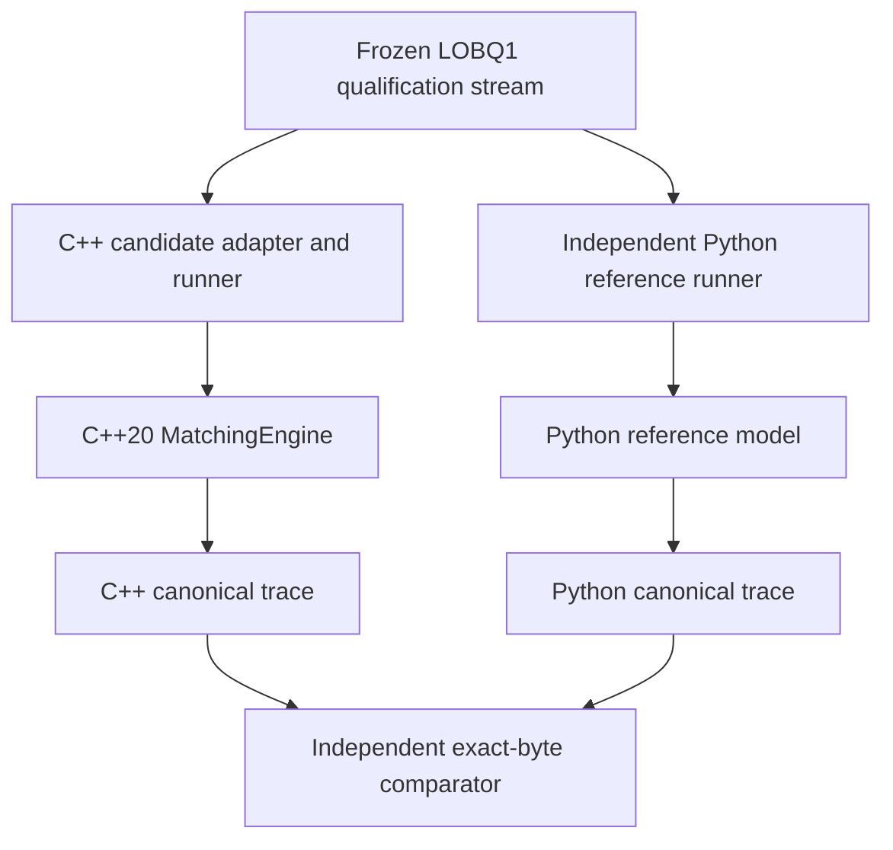

# Deterministic C++20 Limit Order Book

[](https://github.com/Adhish-Rao2405/cpp-limit-order-book/actions/workflows/ci.yml)

A correctness-first trading-systems engineering project: a **C++20 limit order book and matching engine**, an **independently implemented Python reference model**, and a growing **differential-testing and reproducibility framework**.

This is a systems-engineering project rather than a trading application or an exchange simulator. The emphasis is on deterministic behaviour, explicit ownership, precise matching rules, independent testing, and measurable evidence before performance optimisation.

> **Public repository status — 26 October 2026:** The matching core (M3) and independent reference/trace tooling (M4) are qualified. M5 candidate, comparison, corpus-sealing and deterministic-generator components have been merged to `main`; the complete 176-stream differential experiment has **not** been completed. The latest verified public `main` commit is [`a02e438`](https://github.com/Adhish-Rao2405/cpp-limit-order-book/commit/a02e43801f300b0503a855bfa0c9eb2e1f083cb5). The generated corpus and final seal have been qualified in a separate local workflow, but their GitHub publication is not established by the public `main` state.

## What this project demonstrates

| Engineering area | Implemented work |
| --- | --- |
| **C++ and data structures** | Single-writer matching engine using ordered price levels, per-level FIFO queues, and an active-order hash index with typed locators. |
| **Matching correctness** | Price-time priority, maker-price trades, partial/multi-level fills, cancellations, modifications, deterministic snapshots, and explicit sequence exhaustion. |
| **API and state design** | Strong types for prices, quantities, IDs and sequences; typed domain errors; no raw owning pointers or floating-point price comparisons. |
| **Independent verification** | CPython reference model with a different state representation and matching algorithm, plus independent canonical-trace producers. |
| **Adversarial qualification** | Strict qualification transport, exact-byte comparison, malformed-input rejection, fixed/boundary workloads, and tamper-aware corpus-sealing tools. |
| **Engineering workflow** | CMake/Ninja, GoogleTest/CTest, warnings-as-errors, Debug/Release builds, Windows CI, documented design decisions and Git provenance. |

### Matching behaviour in one example

The book receives a resting **sell for 5 units at 101 ticks**. A new **buy for 3 units at 103 ticks** crosses the spread:

1. The engine executes **3 units at 101** — the resting maker's price, not the incoming order's limit.
2. The resting sell remains active with **2 units**.
3. Subsequent eligible orders respect its original priority at that price level.

The implementation also handles multi-level sweeps, cancellation, quantity reductions that retain priority, and replacements that lose priority according to the [frozen matching rules](docs/MATCHING_SEMANTICS.md).

## Architecture

The C++ matching engine owns the book. Its qualification path is deliberately separated from the independent reference model:



The main implementation uses `std::map<Price, std::list<RestingOrder>>` for each side of the book and `std::unordered_map<OrderId, Locator>` for active-order lookup. The reference deliberately uses a flat collection and fresh semantic searches: reproducing the C++ data structures in Python would undermine the independence of the test oracle.

**Important distinction:** the adapter, runners, serializers, comparator and generators exist; their existence does **not** establish agreement across the complete sealed M5 workload. That remains the purpose of the pending M5G–M5I qualification stages.

## Progress and evidence

| Milestone | Status on public `main` | Evidence or boundary |
| --- | --- | --- |
| **M3 — Matching core** | Qualified | 77/77 corrected M3 tests in Debug and Release; [M3 corrective history](https://github.com/Adhish-Rao2405/cpp-limit-order-book/commit/afaf6f4466d47811593d66ddc96d5eb30921159d). |
| **M4 — Independent reference** | Qualified | CPython 3.12.10 reference model and canonical-v1 writer/validator; [M4 PR](https://github.com/Adhish-Rao2405/cpp-limit-order-book/pull/3). |
| **M5A–D — Differential tooling** | Merged and component-qualified | Preregistered protocol, candidate adapter, independent C++ trace producer, comparator and harness. M5D local qualification reported 118/118 CTest cases in both configurations and 31/31 harness tests; [M5D PR](https://github.com/Adhish-Rao2405/cpp-limit-order-book/pull/8). |
| **M5E — Corpus integrity** | Fixed corpus and sealing machinery merged | 32 fixed, 24 boundary and 24 malformed transport streams (80 committed files); [M5E PR](https://github.com/Adhish-Rao2405/cpp-limit-order-book/pull/9). |
| **M5F.2 — Generated workload source** | Merged | Deterministic G1–G4 generator for 96 intended streams and 33,792 semantic positions; [M5F.2 PR](https://github.com/Adhish-Rao2405/cpp-limit-order-book/pull/10). |
| **M5F.3 — Generated corpus and final seal** | **Not on public `main` at this checkpoint** | Local materialisation and seal verification reported; commit/publication outcome requires separate verification. |
| **M5G–I — Full differential experiment, platform matrix and M5 closure** | Pending | No complete sealed-corpus candidate/reference agreement claimed. |

The latest verified [`main` CI run](https://github.com/Adhish-Rao2405/cpp-limit-order-book/actions/runs/38728445086) passed Windows/MSVC Debug, Windows/MSVC Release and the CPython reference-model jobs. The reference CI workflow discovers **74 tests** and executes them in normal and `-O` modes. These are bounded test results, not proof of universal correctness.

### Key design decisions

- **Deterministic single writer:** no hidden concurrency or thread-safety claims; matching state has one mutation authority.
- **Integer price ticks:** avoids floating-point ordering ambiguity in the matching core.
- **Explicit ownership and locators:** the engine owns price levels and FIFO nodes; active-order lookup does not determine execution priority.
- **Failure as data:** expected domain rejections use typed `DomainError` results; malformed transport is handled separately.
- **No silent oracle repair:** canonical serializers preserve observations rather than sorting, normalising or fixing incorrect matching output.
- **Fail-closed experiments:** a mismatch or violated qualification prerequisite stops the active gate; the original failure remains evidence.

## Build and test

Requirements: a C++20 compiler, **CMake 3.25+**, **Ninja**, and the GoogleTest dependency fetched and hash-verified by the configured build. The checked-in presets create out-of-source Debug and Release builds.

```bash
# Debug
cmake --preset debug --fresh
cmake --build --preset debug
ctest --preset debug --output-on-failure

# Release
cmake --preset release --fresh
cmake --build --preset release
ctest --preset release --output-on-failure
```

Windows/MSVC is covered by GitHub Actions. Linux Debug/Release component testing is documented in milestone qualification evidence; **Linux CI and the full cross-platform M5 matrix are not yet claimed**. This repository currently provides a reusable `lob_core` library and qualification runners, not a production trading gateway.

## Explore the code

| Start here | What to inspect |
| --- | --- |
| [`include/lob/matching_engine.hpp`](include/lob/matching_engine.hpp) and [`src/matching_engine.cpp`](src/matching_engine.cpp) | Public engine API, order-book ownership, trade execution and state transitions. |
| [`include/lob/domain/`](include/lob/domain/) | Strong domain types and validated commands. |
| [`tests/unit/`](tests/unit/) | Matching rules, edge cases and state invariants. |
| [`tools/reference_model/`](tools/reference_model/) | Independent Python oracle and canonical trace logic. |
| [`tools/differential/`](tools/differential/) | Candidate/reference runners, exact-byte comparator, generator and corpus-integrity tooling. |
| [`docs/MATCHING_SEMANTICS.md`](docs/MATCHING_SEMANTICS.md) and [`docs/INVARIANTS.md`](docs/INVARIANTS.md) | Normative matching behaviour. |
| [`docs/adr/`](docs/adr/) | Recorded architecture decisions and rejected alternatives. |
| [`docs/M5_DIFFERENTIAL_QUALIFICATION.md`](docs/M5_DIFFERENTIAL_QUALIFICATION.md) | Preregistered M5 test contract (a frozen design document, not a live progress tracker). |

## Roadmap

1. **M5 — Correctness evidence:** publish the sealed corpus; run full candidate/reference differential and metamorphic qualification; complete the cross-platform matrix and final closure.
2. **M6 — Reproducible replay:** build standalone replay and evidence packaging, with verifiable provenance and repeatable results.
3. **M7 — Measurement:** create a controlled benchmark baseline, report throughput and latency distributions, and establish variance and measurement limitations.
4. **M8 — Optimisation:** profile actual bottlenecks, make targeted C++ changes, and demonstrate both correctness preservation and reproducible performance improvement.

The longer-term aim is a technically defensible trading-systems portfolio project. **No production, exchange-grade, high-frequency-trading, latency, throughput or concurrency-readiness claims are made at this stage.**

## Licence

No licence has been selected; until a licence is added, all rights are reserved.
